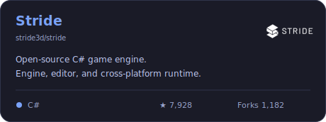
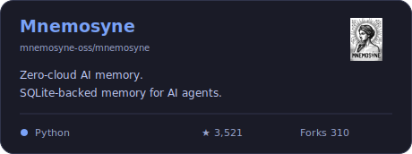
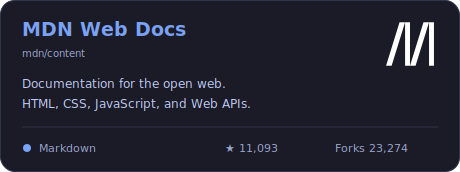
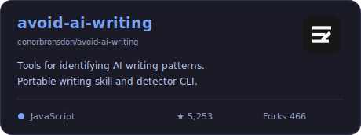

## 🌍 Open Source

Contributed open source projects -

<table>
<tr>
<td width="50%" valign="top">

<strong><a href="https://github.com/stride3d/stride/pull/3577">PR #3577 ↗</a> · <a href="https://github.com/stride3d/stride-community-toolkit/pull/455">Toolkit PR #455 ↗</a></strong>

</td>
<td width="50%" valign="top">

<strong><a href="https://github.com/mnemosyne-oss/mnemosyne/pull/1221">PR #1221 ↗</a></strong>

</td>
</tr>
<tr>
<td width="50%" valign="top">

<strong><a href="https://github.com/mdn/content/pull/45663">PR #45663 ↗</a></strong>

</td>
<td width="50%" valign="top">

<strong><a href="https://github.com/conorbronsdon/avoid-ai-writing/pull/162">PR #162 ↗</a></strong>

</td>
</tr>
</table>

<!-- Demo-only generated snapshot. No automatic refresh is enabled.
Branding sources:
Stride: official upstream README logo, https://media.githubusercontent.com/media/stride3d/stride/84092e8aa924e2039b3f8d968907b48fc699c6b3/sources/data/images/Logo/stride-logo-readme-white.png
Mnemosyne: upstream project artwork, https://github.com/mnemosyne-oss/mnemosyne/blob/main/assets/mnemosyne.jpg
MDN: official upstream mark, https://github.com/mdn/yari/blob/main/client/src/assets/m-logo.svg
avoid-ai-writing: upstream logo, https://github.com/conorbronsdon/avoid-ai-writing/blob/main/assets/logo-dark.svg
Stats fetched from the public repository API during generation; project-wide, not personal contribution counts. Branding does not imply endorsement.
-->
